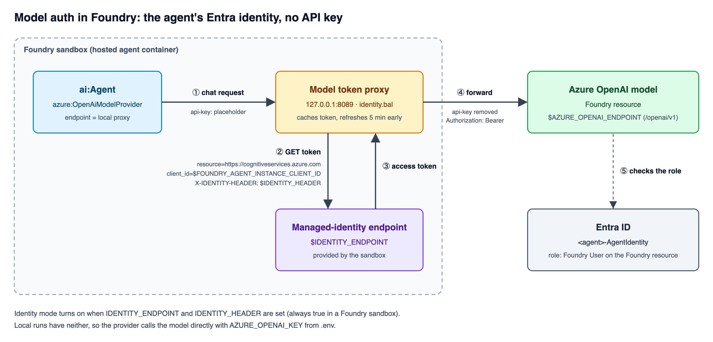

# Deploy a Ballerina agent as a Foundry hosted agent

Step-by-step guide. The names below are this repo's; change them for your own setup.

```sh
RG=rg-foundry-dasuns
LOCATION=eastus
FOUNDRY=foundry-dasuns-demo
PROJECT=ballerina-demo
ACR=acrdasunsdemo
AGENT=bal-demo-agent
MODEL=gpt-4o-mini
```

## 0. Prerequisites

- Ballerina 2201.14+, Docker with `buildx`, Azure CLI, `jq`, `curl`
- `az login`, with the subscription that holds `$RG` selected
- An existing resource group `$RG` that you can create resources in

## 1. Write the agent so it meets the container contract

Your Ballerina service must:

- listen with plain HTTP on port **8088**
- answer `GET /readiness` with `200`
- handle `POST /invocations` (your own JSON in and out)

```ballerina
service / on new http:Listener(8088) {
    resource function get readiness() returns http:Ok => {body: {status: "ready"}};

    resource function post invocations(@http:Payload json body, string? agent_session_id)
            returns json|error {
        // call your ai:Agent here, and key the conversation memory by the session ID
    }
}
```

- Read the model settings from env vars (`AZURE_OPENAI_ENDPOINT`, `MODEL_DEPLOYMENT_NAME`).
- Use `FOUNDRY_AGENT_SESSION_ID` (set by Foundry) as the session key.
- Keep anything that must survive idle in `$HOME`. Memory is lost when the session's sandbox goes idle.
- In Foundry, call the model with the agent's Entra identity, not an API key. See `hr_agent/identity.bal`.



`ballerinax/ai.azure` can only send an `api-key` header, so in Foundry the provider calls a local proxy.
The proxy gets a token from the sandbox's managed-identity endpoint and forwards the call with
`Authorization: Bearer <token>`. The agent identity needs **Foundry User** on the Foundry resource
(step 6). Source for the diagram: `images/model-auth-identity.svg`.

## 2. Add a Dockerfile

Ballerina 2201.14 needs Java 25:

```dockerfile
FROM eclipse-temurin:25-jre
WORKDIR /app
COPY target/bin/<your_package>.jar /app/agent.jar
EXPOSE 8088
ENTRYPOINT ["java", "-jar", "/app/agent.jar"]
```

## 3. Test locally

```sh
cd hr_agent && bal build && cd ..
set -a && source .env && set +a && java -jar hr_agent/target/bin/hr_agent.jar
curl localhost:8088/readiness
curl -X POST localhost:8088/invocations -H 'Content-Type: application/json' -d '{"message":"hi"}'
```

## 4. One-time Azure setup

Skip any resource that already exists.

**Foundry resource and project**

```sh
az cognitiveservices account create -g $RG -n $FOUNDRY -l $LOCATION \
  --kind AIServices --sku S0 --custom-domain $FOUNDRY --allow-project-management \
  --tags RequestedBy=you@example.com
az cognitiveservices account project create -g $RG -n $FOUNDRY --project-name $PROJECT -l $LOCATION
```

**Model deployment** (keep the capacity small)

```sh
az cognitiveservices account deployment create -g $RG -n $FOUNDRY \
  --deployment-name $MODEL --model-name $MODEL --model-version <version> --model-format OpenAI \
  --sku-name GlobalStandard --sku-capacity 10
```

**Container registry**

```sh
az acr create -g $RG -n $ACR --sku Basic -l $LOCATION --tags RequestedBy=you@example.com
```

**Let the project pull images from the registry**

```sh
PROJECT_MI=$(az cognitiveservices account project show -g $RG -n $FOUNDRY --project-name $PROJECT \
  --query identity.principalId -o tsv)
az role assignment create --assignee-object-id $PROJECT_MI --assignee-principal-type ServicePrincipal \
  --role AcrPull --scope $(az acr show -g $RG -n $ACR --query id -o tsv)
```

**`.env`** (copy from `.env.example`, never commit it)

```sh
AZURE_OPENAI_ENDPOINT=https://$FOUNDRY.openai.azure.com/openai/v1
MODEL_DEPLOYMENT_NAME=$MODEL
AZURE_OPENAI_KEY=<key, for local runs only>
```

## 5. Deploy

```sh
./deploy.sh v1      # use a new tag each time: v2, v3, …  Never "latest".
```

`deploy.sh` does the following:

1. runs `bal build`
2. runs `az acr login`, then `docker buildx build --platform linux/amd64 --push`
3. posts the agent definition (image, CPU and memory, the `invocations` protocol, env vars) to
   `https://$FOUNDRY.services.ai.azure.com/api/projects/$PROJECT/agents`. On the first deploy this
   creates the agent; after that, it adds a new version.
4. waits until the version's status is `active`

## 6. First deploy only: give the agent's identity access to the model

Foundry creates an Entra identity called `$AGENT-AgentIdentity` the first time you deploy. Give it
**Foundry User** on the Foundry resource:

```sh
AGENT_ID=$(az ad sp list --display-name "$AGENT-AgentIdentity" --query '[0].id' -o tsv)  # or copy it from the portal
az role assignment create --assignee-object-id $AGENT_ID --assignee-principal-type ServicePrincipal \
  --role "Foundry User" --scope $(az cognitiveservices account show -g $RG -n $FOUNDRY --query id -o tsv)
```

Role assignments can take a few minutes to take effect.

## 7. Invoke

```sh
TOKEN=$(az account get-access-token --resource https://ai.azure.com --query accessToken -o tsv)
URL="https://$FOUNDRY.services.ai.azure.com/api/projects/$PROJECT/agents/$AGENT/endpoint/protocols/invocations?api-version=v1"

# First call: send no session ID. Note the x-agent-session-id response header.
curl -s -D - -X POST "$URL" -H "Authorization: Bearer $TOKEN" -H "Content-Type: application/json" \
  -d '{"message":"How much leave do I have left?","employeeId":"E1001"}'

# Follow-ups: reuse that session ID.
curl -s -X POST "$URL&agent_session_id=<id>" -H "Authorization: Bearer $TOKEN" \
  -H "Content-Type: application/json" -d '{"message":"And sick leave?"}'
```

You can also test the agent in the Foundry portal playground. It sends `{"input": "..."}`.

## 8. Update

Change the code, then run `./deploy.sh v2`. Each deploy creates a new agent version.

## Troubleshooting

| Symptom | Check |
| --- | --- |
| Version status is `failed` | The image isn't linux/amd64, the project can't pull from the registry (`AcrPull`), or `/readiness` isn't on port 8088 |
| `401`/`403` from the model | The agent identity is missing **Foundry User**, or the role hasn't taken effect yet |
| `401` when you invoke | The token was issued for the wrong resource. Use `https://ai.azure.com` |
| The conversation is forgotten | `agent_session_id` wasn't sent, or the session sat idle past its timeout |
| `deploy.sh` says the tag exists | Use a new tag |
