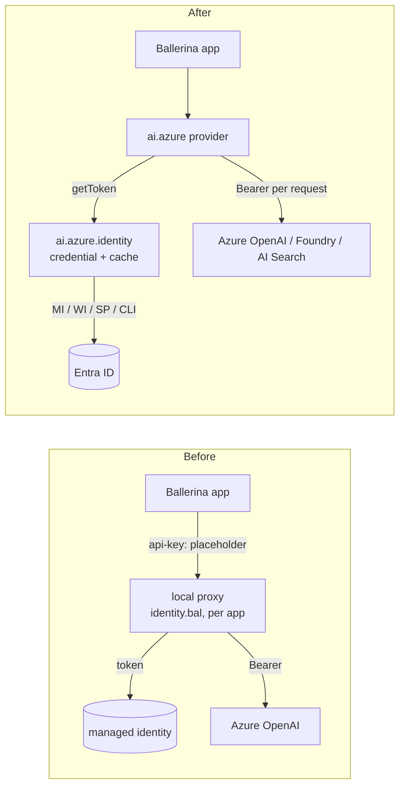

# Keyless (Entra ID) auth for `ballerinax/ai.azure`: summary

A 10-minute walkthrough. Full design, sources and proofs: [entra-auth-ai-azure.md](entra-auth-ai-azure.md).

## Problem

- `ai.azure` only sends a static `api-key`. Teams that disable keys or use managed identity can't use it.
- `http:Client` has no token-provider hook, and a provider can't be wrapped in Ballerina. So every app ends up
  hand-rolling token code.
- Python and Java users write `DefaultAzureCredential()`.

**Today's workaround** (`hr_agent/identity.bal`, ~190 lines): fetch a managed-identity token, cache it, and run a
local proxy on `127.0.0.1:8089`. The proxy swaps the fake `api-key` for `Authorization: Bearer`. It works, but
every agent needs its own copy.

## Before / after



## How it looks

```ballerina
import ballerinax/ai.azure;
import ballerinax/ai.azure.identity;

// Keyless, default chain: Azure CLI on a laptop, managed / workload identity when deployed
final azure:OpenAiModelProvider m1 = check new (url, {'type: "default"}, "gpt-5.5");

// Explicit user-assigned managed identity
final azure:OpenAiModelProvider m2 = check new (url, {'type: "managedIdentity", clientId: miClientId}, "gpt-5.5");

// API key still works, unchanged
final azure:OpenAiModelProvider m3 = check new (url, apiKey, "gpt-5.5");

// Or one configurable for both: key or keyless, chosen per environment
configurable string|identity:CredentialConfig modelAuth = {'type: "default"};
```

```toml
# Config.toml
[myorg.myapp]
modelAuth = {type = "managedIdentity"}      # or {type = "azureCli"}, or "<api key>"
```

In WSO2 Integrator the "Authentication" field offers **Text** (key), **Record** (a *Type* dropdown) or
**Expression**.

## Key decisions

| Decision | Choice | Why |
|---|---|---|
| Where the code lives | **Submodule `ai.azure.identity`** inside `ai.azure`, extract-ready | Fastest to ship; same pattern as `azure.storage.blob`; no new package to own. Ballerina-only public types, so it can be moved later. |
| Token engine | **Java `azure-identity`**, the same jar set `azure.storage.blob` ships, **with TLS/proxy wired in** | Microsoft-maintained protocols and full `DefaultAzureCredential` behaviour. Local proofs pass: `SSL_CERT_FILE` trust works *only* when wired, and it coexists cleanly with `ballerina/http`. |
| Attaching the token | `Authorization: Bearer` **per request** on plain HTTP clients | Works today; `ballerina/http` has no token-provider hook, and the generated connectors only take static tokens |
| API shape | **Widen the existing `apiKey` param**: `string\|CredentialConfig\|TokenCredential` | Non-breaking (minor release); Integrator generates positional code |
| Config format | Records with a required **`type`** field | Config.toml picks the *first* matching union member, so without `type` `{}` becomes the wrong credential |
| Token scope | **Derived from the URL**, overridable | Project endpoint accepts only `ai.azure.com` (tested); Search uses `search.azure.com` |

## Credential sources

| Phase 1 | Phase 2 |
|---|---|
| Default chain (env → workload identity → managed identity → Azure CLI) | Client **certificate** (slot reserved now, non-breaking) |
| Managed identity: App Service style (**Foundry hosted agents**, Container Apps) and IMDS (VMs, AKS) | |
| Workload identity (AKS) · service principal with secret · Azure CLI · static token · your own `TokenCredential` | |

## Open for discussion

| Topic | Question |
|---|---|
| Shared `ballerinax/azure.identity` package | Should identity eventually be one package for all Azure connectors (as Microsoft and `aws.auth` do), with `azure.storage.*` converging on it? |
| `apiKey` naming | `apiKey = <credential>` reads oddly. Rename to `auth` at the next major, or pick another shape? |
| GraalVM (Pc) | The native build of the Java proof is **pending verification** |
| Q1b | Does a classic `kind: OpenAI` resource accept `ai.azure.com` tokens? (Default stays `cognitiveservices` until known) |

## Next steps

1. Review this with the AI team (and the storage owners for jar alignment).
2. File the upstream issue in `ballerina-library` (`module/ai.azure`).
3. Ship `ai.azure` 1.6.0: the `ai.azure.identity` submodule plus widened auth params.
4. Delete `identity.bal` from agents like `hr_agent`, and set `modelAuth` in Config.toml.
