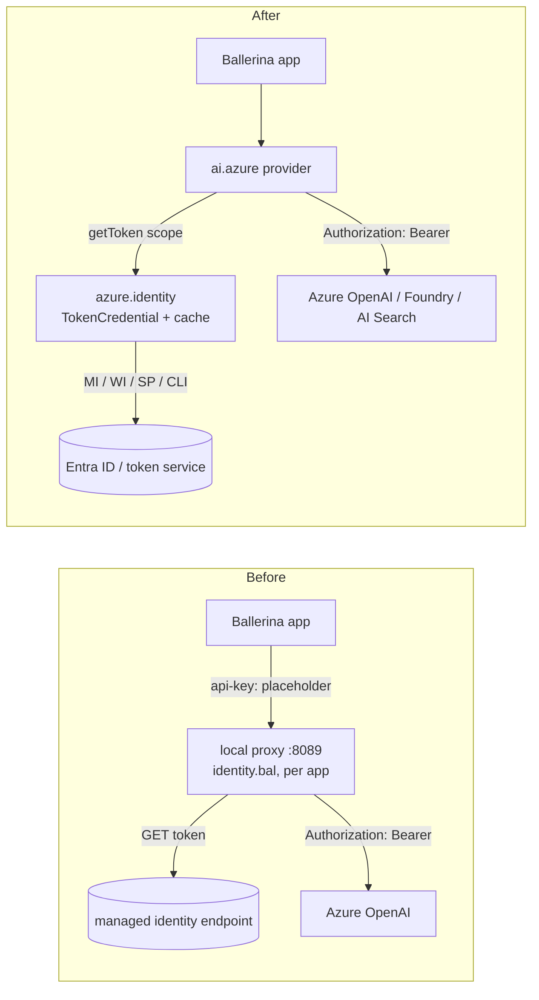
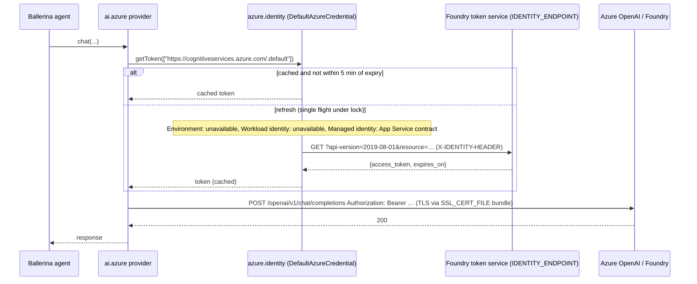
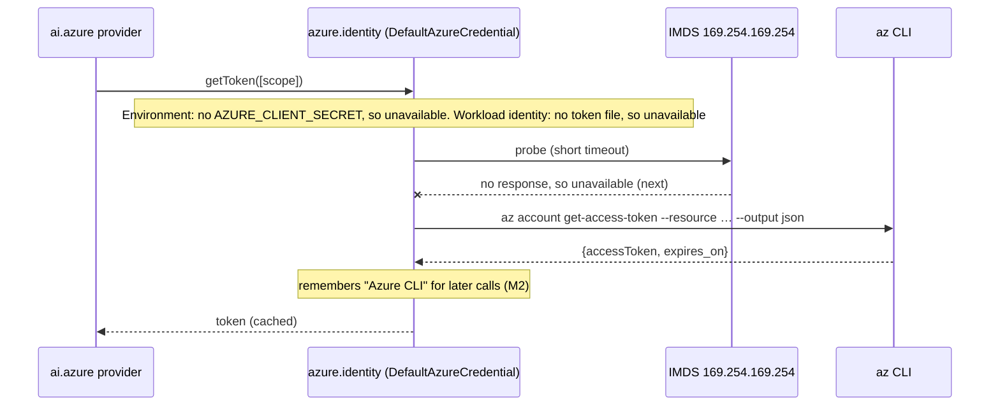
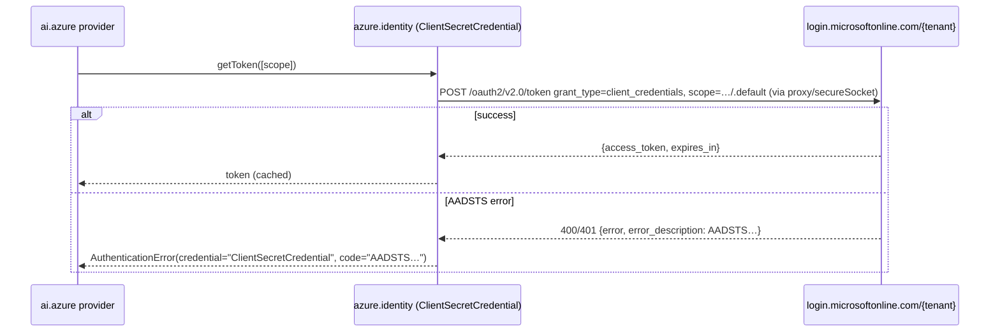

# Design: Microsoft Entra ID (keyless) authentication for `ballerinax/ai.azure`

**Status:** draft for review: research, requirements, options and design complete (Pc GraalVM result pending)
**Audience:** Ballerina AI team (ballerina/ai and ballerinax/ai.* maintainers)

<!-- Sections 1, 2 and 4–9 are filled in at later checkpoints. -->

## 1. Summary

`ballerinax/ai.azure` only supports API keys, so every Ballerina app that wants keyless access to Azure OpenAI,
Foundry or AI Search writes its own token plumbing. This repo's `identity.bal` is a ~190-line token fetcher plus a
local proxy that swaps headers. We propose:

- **A new package `ballerinax/azure.identity`.** Its public API is plain Ballerina: discriminated config records
  for Config.toml and WSO2 Integrator, plus a `TokenCredential` object type. It is backed by Microsoft's Java
  `azure-identity` (as `azure.storage.blob` already is), and the TLS/proxy settings are wired through, so
  `DefaultAzureCredential` semantics work on Foundry hosted agents, Azure compute, AKS, on-prem service principals
  and developer machines.
- **A non-breaking widening of `ai.azure`'s auth parameter.** It becomes `string|CredentialConfig|TokenCredential`.
  `ai.azure` attaches `Authorization: Bearer` per request and derives the token scope from the endpoint URL.

Local proofs back the key claims (§3.9). Live checks covered only Q1/Q2 (§3.6): which scopes each endpoint accepts.



## 2. Problem and requirements

### 2.1 Problem

`ballerinax/ai.azure` can only authenticate with an API key (§3.1). Teams that disable keys
(`disableLocalAuth: true`), or that run on Azure compute with a managed identity, can't use it without workarounds.
The same applies to AKS workload identity, Foundry hosted agents, service principals on-prem, and developers
signed in with `az login`. Users can't work around it themselves:

- `http:ClientConfiguration.auth` has no token-provider hook (H1).
- The OAuth2 config only fits a client secret, and it panics at init (H4, §3.3).
- A provider can't be wrapped in pure Ballerina (A8).

The only option today is a local proxy that swaps headers, like `hr_agent/identity.bal`, copied into every app.
Python and Java users write `DefaultAzureCredential()`.

### 2.2 Functional requirements

| # | Requirement | Priority |
|---|---|---|
| FR1 | Keyless auth for **all** `ai.azure` entry points: `OpenAiModelProvider` (chat and responses, v1 and legacy), `EmbeddingProvider` (v1 and legacy) and `AiSearchKnowledgeBase` (search and index clients). | Must |
| FR2 | Existing code that passes an API key keeps compiling and behaving the same. | Must |
| FR3 | Credential sources: **managed identity** (App Service-style endpoint, which also covers Foundry hosted agents and Container Apps; plus IMDS for VMs, VMSS and AKS node identity), **workload identity** (AKS, federated token file), **service principal with client secret**, **Azure CLI** (developer machines), **static token**, and a **user-supplied token provider** (escape hatch). | Must |
| FR4 | Service principal with **certificate**. Many organisations forbid secrets for service principals. It ships in phase 2, but the phase-1 API must **reserve room** for it, so that adding it is non-breaking (§4.6). | Should (phase 2; API slot in phase 1) |
| FR5 | A **default chain** for "works here and in Azure" without code changes: Environment → Workload identity → Managed identity → Azure CLI. It follows azure-identity's rules: unavailable → next, failure → stop, and remember the source that worked (M1, M2). It can be narrowed to production-only or developer-only sources (like `AZURE_TOKEN_CREDENTIALS`, M3). | Must |
| FR6 | The default **scope** is **derived from the endpoint URL** (§4.7): for example, project endpoint → `ai.azure.com` (§3.6 Observed), Search → `search.azure.com`. It can always be overridden per client. | Must |
| FR7 | Credential settings can be expressed as **plain data** (records, enums, strings), so they work as `configurable` values in Config.toml and as forms in WSO2 Integrator. Objects and functions are only the pro-code escape hatch. | Must |
| FR8 | User-assigned managed identity can be selected by client ID, defaulting to `AZURE_CLIENT_ID` as azure-identity does. | Must |
| FR9 | One credential instance can be **shared** by the model, embedding and knowledge-base clients, with one cache per scope. | Should |
| FR10 | Sovereign clouds: the authority host and scope can be overridden. | Should |
| FR11 | The credential type is not specific to AI: other Azure connectors (Search, Key Vault, Storage…) can reuse it later. | Should |

### 2.3 Non-functional requirements

| # | Requirement |
|---|---|
| NF1 | **Isolated:** the credential and the provider stay `isolated` and are safe under concurrent strands. |
| NF2 | **Caching:** refresh 300 s before expiry, or at `refresh_on` when present; at most one refresh in flight per scope; retry a failed refresh at most every 30 s; keep serving the cached token while it is still valid (M8). |
| NF3 | **No panics, no network calls during construction.** A temporary Entra outage must not crash the program (unlike H4). Errors surface as `ai:Error` on the first call. |
| NF4 | **Error messages** name the credential and the cause. A chain error lists every attempted source and why it was skipped. Service 401/403 responses mention the audience/role as hints. Errors are typed so callers can tell "no credential available" from "denied". |
| NF5 | **Secrets never leak:** tokens, client secrets, assertions and `IDENTITY_HEADER` values are never logged, put in error messages, or added to spans. Token endpoint error bodies are reduced to the `error`/`AADSTS` code and description. |
| NF6 | **TLS and proxies:** token requests to Entra use the same `secureSocket` / `proxy` settings as the service client. This covers Foundry's `SSL_CERT_FILE` CA bundle and corporate proxies. The local metadata endpoints (IMDS, `IDENTITY_ENDPOINT`) are never sent through a proxy. |
| NF7 | **Observability:** log at debug level which source was selected and how long the token lives (never the token itself). Token fetch failures appear as errors on the existing model and embedding spans. |
| NF8 | **Testable without Azure:** every endpoint can be overridden (authority host, IMDS / identity endpoint, CLI command), so unit tests run against mock services. A static or fake credential is available for tests. |
| NF9 | **Bounded startup:** probing the chain takes at most about 1–2 s on machines without IMDS (azure-identity uses a 1 s probe, M7). The Azure CLI call times out after 10 s. |
| NF10 | **Non-breaking:** shipped as a minor release of `ai.azure`. |

### 2.4 Out of scope (v1)

- Interactive or user-delegated flows: browser, device code, username/password, on-behalf-of.
- *Building or testing* IDE and other CLI credentials (VS Code, IntelliJ, PowerShell, azd, the WAM broker, the shared token cache). With the Java option (§4.3) they come with `DefaultAzureCredential` as-is, but this design doesn't promise or test them.
- Managed-identity flavours with tiny reach: Service Fabric, Azure Arc, Azure ML, Cloud Shell. Arc may be revisited for on-prem.
- Continuous access evaluation (CAE) and claims challenges, and persisting tokens to disk.
- Changing the other `ai.*` providers. §7 only states what this design means for them.
- Foundry-specific features (agent identity blueprints, OBO for agents).

## 3. Verified facts and open questions

Source snapshots used for every code reference below:

| Repo (github.com/ballerina-platform) | Commit | Package version |
|---|---|---|
| module-ballerinax-ai.azure | `5fd8ed1` (2026-10-15) | 1.5.1 (identical to the published 1.5.1 bala) |
| module-ballerina-http | `d710c4a` (2026-11-12) | 2.18.3-SNAPSHOT (experiments ran on 2.18.2) |
| module-ballerina-oauth2 | `604caa6` (2026-10-20) | 2.15.1-SNAPSHOT |
| module-ballerina-jwt | `29a35f5` | 2.15.2-SNAPSHOT |
| module-ballerina-ai | `f64e392` (2026-11-11) | 1.17.0-SNAPSHOT |
| ai.anthropic / ai.aws.bedrock / ai.googleapis.vertex / ai.openrouter | `df74901` / `8184e48` / `862f555` / `9633195` | 1.4.0 / 1.0.1 / 1.0.3 / 1.0.3 |
| Generated connectors (published balas) | — | azure.openai.chat 4.0.0, azure.openai.responses 1.0.0, azure.openai.embeddings 1.0.2, azure.ai.search(.index) 1.0.2, ballerinax/aws 1.1.0 |

Microsoft sources: azure-identity Python `main` (1.27.x, MSAL Python 1.39.0) and azure-identity Java `main`
(1.20.0-beta.1; latest Maven release 1.19.0), plus the Microsoft Learn pages linked inline.

Experiments ran locally on Ballerina 2201.14.0 against mock endpoints only (no Azure). Their source is in
[`entra-auth-experiments/`](entra-auth-experiments/).

### 3.1 `ai.azure` today

| # | Fact | Source |
|---|---|---|
| A1 | Every request authenticates with a static `api-key` header. `ConnectionConfig` has no `auth` field. | `ballerina/types.bal` (ConnectionConfig) |
| A2 | `OpenAiModelProvider.init(serviceUrl, string apiKey, deploymentId, ...)` | `model-provider.bal:87-96` |
| A3 | The model provider has four wire paths. Chat v1 and Responses v1 go through the generated connectors with `auth: {api-key}`. Chat legacy and Responses legacy go through a raw `http:Client` with a per-call `{"api-key": apiKey}` header. | `provider_utils.bal:523-524, 383-385`; `responses_utils.bal:355-356, 310-311` |
| A4 | `EmbeddingProvider.init(serviceUrl, string accessToken, apiVersion, deploymentId, ...)`. The parameter is named and labelled **"Access Token" but is sent as `api-key`**, so the existing name is misleading. v1 uses a raw client with a per-call header; legacy uses the generated `azure.openai.embeddings` with `auth: {apiKey}`. | `embedding_provider.bal:62-67, 183-186, 237` |
| A5 | `AiSearchKnowledgeBase.init(serviceUrl, string apiKey, index, ...)` passes `{"api-key": apiKey}` as a per-call header on every `azure.ai.search` / `azure.ai.search.index` call. Those connectors' `ConnectionConfig` has **no `auth` field**. | `azure_ai_search_knowledgebase.bal:113, 141, 154, 214, 299, 346, 383`; `azure.ai.search` 1.0.2 `types.bal:129` |
| A6 | Generated `azure.openai.{chat,responses,embeddings}` take `auth: http:BearerTokenConfig\|ApiKeysConfig` (required). A bearer token is passed into `http:ClientConfiguration.auth` as a **static** token. | `azure.openai.chat` 4.0.0 `types.bal:138`, `client.bal:31-39` |
| A7 | **Experiment E-H:** with a static `BearerTokenConfig`, the configured token **overrides** a per-call `Authorization` header. With `ApiKeysConfig`, an `api-key` header is **always** sent, even an empty one. So a refreshing token cannot be attached *cleanly* through today's generated connectors. (Azure OpenAI itself tolerates the stray empty `api-key` when a valid Bearer is present: Q2 in §3.8.) | [`headers/main.bal`](entra-auth-experiments/headers/main.bal); http `auth_client_bearer_token_auth_handler.bal:34` (`setHeader` overwrites) |
| A8 | `ai:ModelProvider.generate` is dependently typed and implemented as `external` in every provider. A pure-Ballerina wrapper that delegates to an inner provider does not compile (`a function with a non-'external' function body cannot be a dependently-typed function`). Users therefore can't fix auth by wrapping a provider. | ai `model-provider.bal:117-133`; [`dtcheck/main.bal`](entra-auth-experiments/dtcheck/main.bal) |

### 3.2 `ballerina/http` and `ballerina/oauth2`

| # | Fact | Source |
|---|---|---|
| H1 | `http:ClientAuthConfig = CredentialsConfig\|BearerTokenConfig\|JwtIssuerConfig\|OAuth2GrantConfig`. It is closed: there is **no custom token-provider / custom handler hook**. The internal `ClientAuthHandler` union is non-public, and `enrichRequest` panics on any other type. | http `auth_types.bal:97,100`; `http_secure_client.bal:232,238-254` |
| H2 | When `auth` is set, `Authorization` is computed **per request**, on every remote method. OAuth2 calls `generateToken()` each time and serves it from cache. | `http_secure_client.bal:55-160`; `auth_client_oauth2_handler.bal:36-38` |
| H3 | OAuth2 grants supported: client_credentials, password, refresh_token, jwt-bearer. | oauth2 `client_oauth2_provider.bal:155,227-237` |
| H4 | `ClientOAuth2Provider.init` **fetches a token eagerly and panics on failure**. `http:Client\|error c = new (...)` does not catch it (experiment E9: process exits with the error, stack through `ClientOAuth2Provider:init`). | `client_oauth2_provider.bal:201-209`; [`panictest/main.bal`](entra-auth-experiments/panictest/main.bal) |
| H5 | The token cache refreshes at `expires_in - clockSkew`, and `clockSkew` **defaults to 0** (no early refresh). The refresh is single-flight under `lock`: in E5, 20 concurrent calls after expiry made 1 token fetch. | `client_oauth2_provider.bal:40,246-254,683-692`; [`authexp/main.bal`](entra-auth-experiments/authexp/main.bal) E4/E5 |
| H6 | The client-credentials grant **requires a non-empty `clientSecret`**. It sends it as Basic auth (default) or in the body; client authentication can't be turned off. Values are not URL-encoded. | `client_oauth2_provider.bal:315-317,569-615`; `oauth2_commons.bal:73-76`; E2, E8 |
| H7 | `optionalParams` can inject `client_assertion` / `client_assertion_type` (E1). But the config is `cloneReadOnly()` at init, so the assertion is **frozen**: it can't be re-signed or re-read from a rotating file. The dummy secret is still sent alongside it. | `client_oauth2_provider.bal:202`; E1, E5 |
| H8 | The JWT-bearer grant sends `grant_type=urn:ietf:params:oauth:grant-type:jwt-bearer&assertion=…` (RFC 7523 §2.1). That is **not** Entra's client-assertion flow, which is `grant_type=client_credentials` + `client_assertion`. | `client_oauth2_provider.bal:403,412`; E3; [Entra client-creds flow](https://learn.microsoft.com/en-us/entra/identity-platform/v2-oauth2-client-creds-grant-flow) |
| H9 | There is no 401 handling. A 401 is returned as-is; `retryConfig.statusCodes:[401]` re-sends the same cached token. | E6, E7; `http_client_endpoint.bal:648-661` |
| H10 | `ballerina/jwt` can't build an Entra certificate assertion. The header supports only `alg/typ/cty/kid` (no `x5t#S256`), and the only algorithms are RS/HS (no PS256). `crypto:signRsaSsaPss256` exists, so it is buildable by hand. | jwt `jwt_commons.bal:20,64-69`; `jwt_issuer.bal:30-39`; crypto 2.12.2 `sign_verify.bal:94,154` |

### 3.3 Credential sources → can `ballerina/http` + `oauth2` do it?

| Source | Wire protocol | Fits http/oauth2 config? | Why |
|---|---|---|---|
| Service principal + client secret | `POST {authority}/{tenant}/oauth2/v2.0/token`, `client_credentials`, `scope=<res>/.default` | **Yes, with caveats** | `OAuth2ClientCredentialsGrantConfig` works (E1/E2). Caveats: init panics if Entra is unreachable (H4), `clockSkew` must be set (H5), values aren't URL-encoded (H6). |
| Service principal + certificate | `client_credentials` + `client_assertion` (JWT signed with cert, `x5t#S256`) | **No (custom)** | A fresh signed assertion is needed per fetch, but `optionalParams` is frozen (H7), a dummy secret is forced (H6), and jwt can't set `x5t` (H10). |
| Workload identity (AKS, federated) | `client_credentials` + `client_assertion` = `AZURE_FEDERATED_TOKEN_FILE` contents | **No (custom, small)** | The file rotates, so it must be re-read per fetch; `optionalParams` is frozen (H7); a dummy secret is forced (H6). |
| Managed identity, IMDS | `GET 169.254.169.254/metadata/identity/oauth2/token?api-version=2018-02-01&resource=…`, `Metadata: true` | **No (custom)** | It is a GET with a custom header, not an OAuth2 token request (oauth2 only POSTs: `OAuth2Client.java:314,324`). |
| Managed identity, App Service-style (App Service, Container Apps, **Foundry hosted agents**) | `GET {IDENTITY_ENDPOINT}?api-version=2019-08-01&resource=…[&client_id=…]`, `X-IDENTITY-HEADER` | **No (custom)** | Same as IMDS. `expires_on` is an epoch **string**; oauth2's parser expects an int `expires_in` (`client_oauth2_provider.bal:636-642`). |
| Azure CLI (developer machine) | subprocess `az account get-access-token --output json --resource <res> [--tenant …]` | **No (custom)** | It is a process call, not HTTP. |
| Static token / user-supplied provider | — | Static: **yes** (`BearerTokenConfig`). Provider: **no** | No callback hook (H1). |

Conclusion: only the client-secret path is pure configuration, and even that has the init-panic caveat. Every
other source needs a small token-credential object (get token → cache → refresh) and a way to attach its token per
request.

### 3.4 How Microsoft's azure-identity behaves (the reference we compare against)

| # | Fact | Source |
|---|---|---|
| M1 | `DefaultAzureCredential` order. Python: Environment → WorkloadIdentity → ManagedIdentity → SharedTokenCache (Windows) → VS Code → Azure CLI → PowerShell → azd → Broker (InteractiveBrowser excluded). Java: the same minus SharedTokenCache, plus IntelliJ. | py `_credentials/default.py:263-313`; java `DefaultAzureCredentialBuilder.java:378-394` |
| M2 | Chain rule: "unavailable" → try the next credential; any other failure → **stop** and raise. Once a credential succeeds, the chain **remembers it**. | py `chained.py:131-159`; java `ChainedTokenCredential.java:129-144,175-189` |
| M3 | `AZURE_TOKEN_CREDENTIALS=dev\|prod\|<credential name>` narrows the chain. `prod` = Environment, WorkloadIdentity, ManagedIdentity. | py `_internal/utils.py:186-245`; java `DefaultAzureCredentialBuilder.java:329-370` |
| M4 | EnvironmentCredential: `AZURE_TENANT_ID` + `AZURE_CLIENT_ID` + one of `AZURE_CLIENT_SECRET` / `AZURE_CLIENT_CERTIFICATE_PATH` (+`_PASSWORD`) / `AZURE_USERNAME`+`AZURE_PASSWORD`. `AZURE_AUTHORITY_HOST` overrides `login.microsoftonline.com`. | py `environment.py:63-86`, `_constants.py:47-56` |
| M5 | Workload identity: `AZURE_TENANT_ID`, `AZURE_CLIENT_ID`, `AZURE_FEDERATED_TOKEN_FILE`. Python re-reads the file at most every 600 s; Java re-reads it on every assertion. | py `workload_identity.py:41-46,93-95`; java `WorkloadIdentityCredential.java:146-165` |
| M6 | Managed identity source detection, in order: Service Fabric (`IDENTITY_SERVER_THUMBPRINT`) → App Service (`IDENTITY_ENDPOINT`+`IDENTITY_HEADER`) → Arc → Azure ML (`MSI_ENDPOINT`+`MSI_SECRET`) → Cloud Shell (`MSI_ENDPOINT`) → IMDS. The resource is the scope minus `/.default`, and exactly one scope is allowed. | py `managed_identity.py:82-143`, `_internal/__init__.py:26-41` |
| M7 | IMDS inside a chain is probed once with a 1 s timeout; no response means "unavailable". Standalone, it retries 5× with backoff on 404/410/429/5xx. | py `imds.py:25-56,105-151` |
| M8 | Caching: refresh when ≤ 300 s remain or at `refresh_on` (= `expires_in/2` when the lifetime is ≥ 2 h). Retry a failed refresh at most every 30 s, and keep serving the still-valid token if a refresh fails. Java's `AccessTokenCache` is single-flight (lock). Python's sync pipeline policy is **not** locked. | py `_constants.py:10-11`, `utils.py:36-66`, `get_token_mixin.py:131-137`; java `AccessTokenCache.java:80-151,260-310` |
| M9 | Azure CLI: `az account get-access-token --output json --resource <res> [--tenant …]`, 10 s timeout, run with a fixed cwd. The CLI is "unavailable" if `az` isn't found or isn't logged in. It prefers `expires_on` (epoch) over `expiresOn` (local time). | py `azure_cli.py:34-35,177-306` |
| M10 | Java azure-identity 1.19.0 pulls in `azure-core`, `azure-core-http-netty` (reactor-netty), `msal4j`, `msal4j-persistence-extension` and `jna-platform` at compile scope. | Maven Central `com.azure:azure-identity:1.19.0` POM |

### 3.5 Foundry hosted agents (one environment among many)

| # | Fact | Source |
|---|---|---|
| F1 | Each hosted agent gets its own Entra **agent identity**. Code gets tokens from the hosted-agent token service, and Microsoft's guidance is to use `DefaultAzureCredential` / `ManagedIdentityCredential`. The project's managed identity is not available to agent code. | [hosted-agent-token-service](https://learn.microsoft.com/en-us/azure/foundry/agents/concepts/hosted-agent-token-service), [agent-identity](https://learn.microsoft.com/en-us/azure/foundry/agents/concepts/agent-identity) |
| F2 | The token service uses **exactly the App Service contract**: `IDENTITY_ENDPOINT`, `IDENTITY_HEADER`, `api-version=2019-08-01`, `resource=` (not `/.default`), optional `client_id`, and a response with `expires_on` as a unix-time string. | same page |
| F3 | Calling the account endpoint directly needs *Cognitive Services OpenAI User* or *Foundry User* on the agent identity. Inference through the project endpoint is allowed by default. | [hosted-agent-permissions](https://learn.microsoft.com/en-us/azure/foundry/agents/concepts/hosted-agent-permissions) |
| F4 | So a generic App Service-style managed-identity source covers Foundry hosted agents. **No Foundry-specific code is needed.** | F2 + M6 |

### 3.6 Token audiences (scopes)

| Endpoint | Scope | Source |
|---|---|---|
| Azure OpenAI v1 (`…openai.azure.com/openai/v1`, `…services.ai.azure.com/openai/v1`) | `https://ai.azure.com/.default` (v1 page); `https://cognitiveservices.azure.com/.default` (starter kit). Docs show both. | [api-version-lifecycle](https://learn.microsoft.com/en-us/azure/foundry/openai/api-version-lifecycle); [starter kit](https://learn.microsoft.com/en-us/azure/developer/ai/get-started-azure-openai-starter-kit) |
| Foundry Models | "Tokens must be issued with scope `https://ai.azure.com/.default`" | [configure-entra-id](https://learn.microsoft.com/en-us/azure/foundry/foundry-models/how-to/configure-entra-id) |
| Azure OpenAI legacy (`/openai/deployments/…?api-version=`) | Reference page names no scope; samples use `https://cognitiveservices.azure.com/.default` | [reference](https://learn.microsoft.com/en-us/azure/foundry/openai/reference) |
| Foundry project endpoint (`…/api/projects/<p>`) | `https://ai.azure.com/.default` | [sdk-overview](https://learn.microsoft.com/en-us/azure/foundry/how-to/develop/sdk-overview) |
| Claude on Foundry (`…services.ai.azure.com/anthropic/v1/messages`) | `https://ai.azure.com/.default`, `Authorization: Bearer`. Key auth uses `x-api-key`. | [use-foundry-models-claude](https://learn.microsoft.com/en-us/azure/foundry/foundry-models/how-to/use-foundry-models-claude); [Anthropic: Claude in Foundry](https://platform.claude.com/docs/en/build-with-claude/claude-in-microsoft-foundry) |
| Azure AI Search data plane | `https://search.azure.com/.default`. The service must have RBAC enabled ("Role-based access control" or "Both"); the default is keys only. | [search-security-enable-roles](https://learn.microsoft.com/en-us/azure/search/search-security-enable-roles) |
| Sovereign clouds | Authority `login.microsoftonline.us` / `login.chinacloudapi.cn`; Gov AOAI uses `https://cognitiveservices.azure.us/.default` | py `_constants.py:34-36`; Azure Government docs |

**Observed (Q1, 2026-11-13).** These were read-only calls with an `az login` user token (role *Foundry User*)
against an `AIServices` account and a `gpt-5.5` deployment, each with one minimal prompt. Only the HTTP status
was recorded. The script is [`probe.sh`](entra-auth-experiments/probe.sh).

| Endpoint | Token for `cognitiveservices.azure.com` | Token for `ai.azure.com` |
|---|---|---|
| v1 chat, `<res>.openai.azure.com/openai/v1` | 200 | 200 |
| v1 chat, `<res>.services.ai.azure.com/openai/v1` | 200 | 200 |
| legacy chat, `/openai/deployments/<d>/chat/completions?api-version=2024-10-21` | 200 | 200 |
| project, `GET /api/projects/<p>/deployments?api-version=v1` | **401** "audience is incorrect (https://ai.azure.com)" | 200 |
| project, v1 chat `/api/projects/<p>/openai/v1/chat/completions` | **401** | 200 |

So account-level endpoints accept **both** audiences, while the **project endpoint accepts only `ai.azure.com`**.
This was not tested on a classic `kind: OpenAI` resource or in a sovereign cloud (see Q1b).

### 3.7 Existing Ballerina building blocks

| # | Fact | Source |
|---|---|---|
| B1 | No Azure identity / credential package exists on Ballerina Central (`azure.identity`, `azure_identity`, `azure.auth`, `entra`, `microsoft.entra`: 404). `ballerinax/azure.ad` is a Microsoft Graph user/group connector. | Central registry API, `bal search` |
| B2 | ~~No Azure connector supports Entra today.~~ **Corrected:** `ballerinax/azure.storage.blob` 1.0.0 (released 2026-10-23) and `azure.storage.files` 1.2.0 (released 2026-10-19) **support Entra ID through Java `azure-identity` interop** (B9). Other Azure connectors use keys, SAS, static bearer tokens or `http` OAuth2 grants (table below). | Central registry API; release tags `v1.0.0` / `v1.2.0`; table below |
| B3 | **Precedent:** `ballerinax/aws` 1.1.0 ships `aws.auth`: `AuthConfig = Static\|Profile\|AssumeRole\|WebIdentity\|Sso\|Process\|DEFAULT_CREDENTIALS` plus an isolated `CredentialProvider` (Java AWS SDK v2 underneath, cached and refreshed). `ai.aws.bedrock` consumes it through a union-typed `auth` param. | `ballerinax/aws` 1.1.0 `modules/aws.auth/types.bal:19-37`, `credential_provider.bal:17-59`; bedrock `types.bal:25-34` |
| B4 | ballerina/ai has no shared model-provider auth abstraction. The only `auth` in ai types is for MCP/tools (`http:ClientAuthConfig\|AgentIdAuthConfig`). | ai `types.bal:173,200,223` |
| B5 | WSO2 Integrator renders a union-typed parameter as several input modes: all record members merged into one **record form with a "Type" dropdown** (one sub-form per record), string constants as a **select**, `string` as **text**, plus **expression**. Example: Vertex's `OAuth2RefreshConfig\|ServiceAccountConfig\|string` → `[RECORD_MAP_EXPRESSION{2 records}, TEXT, EXPRESSION]`. Labels come from `@display`; `*ConnectionConfig` fields are flattened into "advanced" fields. | ballerina-platform/ballerina-vscode `4352694`, `packages/ballerina-language-server/flow-model-generator/.../core/model/Property.java:792-890`, `ModelProviderBuilder.java:131-191`; UI `ballerina-visualizer/.../RecordConfigModal.tsx:768-774`; test `node_template/config/function_call-user-union2.json` |
| B6 | Integrator's model-provider picker is not hard-coded: it lists `ballerinax/ai.*` packages that depend on `ballerina/ai` and carry the "Model Provider" keyword, and treats a class as a model provider if it includes `ai:ModelProvider`. **Generated code passes required params positionally** (`check new ("url", "key", "deployment-id", "api-version")`). Defaultable params are positional until one is skipped; included-record fields are named. So renaming the required `apiKey` param doesn't break Integrator-generated code, but changing its position does. No test resource covers `ai.aws.bedrock`; Integrator generates no configurables automatically. | `AiUtils.java:174-175,720-732,1185-1215`; `SourceBuilder.java:811-900`; fixture `source/model_provider/connections.bal:10` |
| B7 | Union-of-records `configurable` values are supported, but Config.toml has **no discriminator: the first union member that fits wins**. `a = {}` resolved to the first all-optional record (managed identity, not CLI). In code, the literal `{}` against the same union is a **compile error ("ambiguous type")**. With a required singleton field (`type = "azureCli"`) both resolve unambiguously. `aws.auth` has no discriminator, and its `ProfileAuthConfig` (all fields defaulted) matches `{}`. | [`unioncfg/`](entra-auth-experiments/unioncfg/); runtime `TomlProvider.java:634-656`, `TypeConverter.java:372-412` (ballerina-lang `ef5de61`) |
| B8 | Bedrock labels the param `@display {label: "Authentication"}`, but neither `BearerToken` nor the `aws.auth` records have `@display` on their fields (Integrator shows title-cased field names). Its README shows only Ballerina literals, with no Config.toml example. | bedrock `provider_runtime_amazon.bal:48`, `types.bal:25-34`, `README.md:90-105`; `aws` 1.1.0 `aws.auth/types.bal` |
| B9 | **In-house precedent, `azure.storage.blob` 1.0.0 / `azure.storage.files` 1.2.0.** `AuthConfig = SharedKey\|Sas\|SasUrl\|ConnectionString\|EntraIdConfig`.<br>• blob: `EntraIdConfig = EntraIdChainConfig{kind: DEFAULT_AZURE_CREDENTIAL\|MANAGED_IDENTITY}\|ClientSecretConfig\|ClientCertificateConfig\|WorkloadIdentityConfig`. files uses the same idea with two records (`DefaultEntraIdConfig`, `ManagedIdentityConfig`), each with a `kind` singleton, so **the two siblings already differ in shape**.<br>• Every Entra record also carries `accountName` / `serviceUrl` (service-specific). The variant is picked **by which fields are present** (secret → certificate → token file → `kind`).<br>• Native `Credentials.entraCredential` maps to `ClientSecret`/`ClientCertificate`/`WorkloadIdentity`/`ManagedIdentity`/`DefaultAzureCredentialBuilder`.<br>• There is no Azure CLI-only option, no static token, and no user-supplied credential object. | blob `ballerina/types.bal:60-135`, `native/.../util/Credentials.java:348-396`; files `ballerina/types.bal:523-612` |
| B10 | **How storage handled the jar clashes: by curation.** It lists 43 jars explicitly: `azure-identity` 1.18.4, `azure-core` 1.58.1, `azure-core-http-netty` 1.16.5, msal4j 1.23.1 (+ persistence extension and JNA), Reactor, Jackson 2.18.7, and **every Netty jar pinned to 4.2.18.Final, the version `ballerina/http` ships** (not the 4.2.19 the Azure BOM would bring). The bala is 43 jars / 17.2 MB. `graalvmCompatible = true`, and a `bal test --graalvm` workflow exists. Entra is covered only by gated *live* client-secret tests; there are no repo tests for managed identity, workload identity or the default chain. | blob `ballerina/Ballerina.toml:14-240`; `.github/workflows/build-with-bal-test-native.yml`; `tests/advanced_tests.bal:481-489` |
| B11 | **Storage's TLS/proxy config does not reach its credentials.** `secureSocket`/`proxy` are mapped to a Netty `HttpClient` for the *service* client (`ClientInit.java:146-147`, `TransportConfigMapper.java:157-253`), but `entraCredential` builds every credential **without `.httpClient(...)`**. So token requests use azure-identity's default client and the JVM truststore. azure-core's default client reads `HTTPS_PROXY` only if `java.net.useSystemProxies=true`. | `Credentials.java:353-396`; azure-core `ProxyOptions.java:258` |

#### Azure connectors' auth today (released versions on Central)

| Package (latest on Central) | Auth today | Entra / managed identity? | Source (released bala) |
|---|---|---|---|
| `azure.storage.blob` 1.0.0, `azure.storage.files` 1.2.0 | shared key, SAS, SAS URL, connection string, **Entra** (default chain, MI, client secret, certificate, workload identity) | ✓ via Java `azure-identity` 1.18.4 | B9 |
| `azure_storage_service` 4.4.0 | access key or SAS (`auth` typed `never`) | ✗ | `modules/blobs/types.bal:24-34` |
| `azure.keyvault` 1.6.1 | `http:BearerTokenConfig` (static token; no refresh) | static token only | `types.bal:24` |
| `azure.datalake` 2.0.0 | `OAuth2ClientCredentialsGrantConfig\|http:BearerTokenConfig\|OAuth2RefreshTokenGrantConfig` | client secret via `http` OAuth2 (with the init-panic caveat, H4) or a static token | `types.bal:362` |
| `azure.ad` 2.5.0 (Microsoft Graph users/groups) | `http:BearerTokenConfig\|OAuth2RefreshTokenGrantConfig` | static token or refresh token | `types.bal:25` |
| `azure_cosmosdb` 4.5.0 | `primaryKeyOrResourceToken` (Java Cosmos SDK, `azure-core` 1.59.1) | ✗ | `types.bal:25-33` |
| `azure_eventhub` 3.1.0 | SAS key name and key, signed in Ballerina (`auth` typed `never`) | ✗ | `types.bal:23-31` |
| `azure.textanalytics` 1.5.2 | `ApiKeysConfig` → `Ocp-Apim-Subscription-Key` header | ✗ | `client.bal:24-33`, `types.bal:79` |
| `asb` 3.10.1 | SAS connection string (Java Service Bus SDK, `azure-core` 1.54.1) | ✗ | `types.bal:128,218` |
| `azure.openai.*`, `azure.ai.search*`, `ai.azure` 1.5.1 | api-key (static `BearerTokenConfig` allowed on generated `azure.openai.*`) | ✗ | §3.1 |

Repo `main` branches are ahead of Central for several of these (keyvault 2.0.0, textanalytics 2.0.0, a renamed
`azure.eventhub` 4.0.0), with the same auth shapes. Two unreleased AI loaders, `ai.azure.storage.blobs` /
`.files` 0.9.0, build on `azure_storage_service`.

### 3.9 Java interop proofs (local, mock endpoints only)

The proof app is a Ballerina program plus a ~60-line Java shim around **the exact jar set `azure.storage.blob`
1.0.0 ships** (37 identity-related jars). It calls a local HTTPS mock of the Entra token endpoint and of the App
Service-style managed-identity endpoint. The mock's TLS certificate is signed by a throwaway CA standing in for
Foundry's TLS-inspecting egress proxy, and `SSL_CERT_FILE` points at a bundle with that CA. Source:
[`java-identity/`](entra-auth-experiments/java-identity/) (`setup.sh` then `run.sh`).

| # | Proof | Result |
|---|---|---|
| Pa1 | azure-identity's **default** HTTP client against the "proxy" CA (client secret via MSAL, and managed identity over HTTPS) | **✗ fails:** `SunCertPathBuilderException: unable to find valid certification path`. Java azure-identity does **not** read `SSL_CERT_FILE`. |
| Pa2 | Credential builders given `.httpClient(...)`: a Netty client whose `SslContext` trusts the PEM bundle from `SSL_CERT_FILE` | **✓ passes** for both the client secret (MSAL honours the azure-core client) and HTTPS managed identity |
| Pa3 | `ManagedIdentityCredential` against the App Service contract (= Foundry hosted-agent token service, F2) | **✓:** `GET {IDENTITY_ENDPOINT}?api-version=2019-08-01&resource=…` with `X-IDENTITY-HEADER`, and no `client_id` unless one is configured. Over plain HTTP it works with the default client. |
| Pb1 | Aligned jar set (Netty 4.2.18 = `ballerina/http`'s) + `ballerina/http` in one app | **✓:** no build warnings. A Ballerina `http:Client` (TLS) and azure-identity's reactor-netty work interleaved in one JVM. |
| Pb2 | Same, but identity jars on Netty **4.2.19** (what the Azure BOM brings) | ✓ runs. The build prints `Detected conflicting jar files` for every Netty jar and packages **one** copy (http's 4.2.18). |
| Pb3 | Identity set (`azure-core` 1.58.1, Jackson 2.18.7) + `azure_cosmosdb` 4.5.0 (`azure-core` 1.59.1, Jackson 2.18.11) | ✓ builds with conflict warnings and packages the **older** `azure-core` 1.58.1. Identity works; cosmosdb running on the older core was **not** verified (Q10, partly answered). |
| Pc | `bal build --graalvm` (GraalVM CE 25.0.5) of the proof app and of a pure-Ballerina control | _pending: filled in below_ |

Weight: the identity set is **37 jars / 15.6 MB**. About 5 MB of it is Netty 4.2.18, identical to the copy
`ballerina/http` already ships, so the net addition is **~10.6 MB**.

### 3.8 Open questions

| # | Question | How to verify | Blocks |
|---|---|---|---|
| ~~Q1~~ | **Answered (§3.6 "Observed")**: account endpoints (v1 and legacy) accept both audiences; the project endpoint accepts only `ai.azure.com`. | `probe.sh` | — |
| Q1b | Does a classic `kind: OpenAI` resource, or a sovereign cloud, accept `ai.azure.com` tokens? | Same probe against a classic AOAI resource (none in our resource group) | Whether `ai.azure.com` can be the single default |
| ~~Q2~~ | **Answered**: Azure OpenAI returns 200 when a valid Bearer token comes with an **empty or placeholder `api-key`** header (v1 and legacy). An APIM front end with key-validation policies was not tested. | `probe.sh` | — |
| Q2b | Do APIM / gateway front ends reject a junk `api-key` sent next to a Bearer token? | Test against an APIM instance with `validate-azure-ad-token` and a subscription-key policy | Whether the "dummy api-key" shortcut is safe in general (it is not proposed) |
| Q3 | Does the Foundry token service ever return `expires_in` / `refresh_in`, or set other identity env vars? | Log env var **names** and response **keys** (never values) in a test agent | Parser robustness (we already accept both) |
| Q4 | `FOUNDRY_AGENT_INSTANCE_CLIENT_ID` (used by identity.bal, taken from Microsoft Agent Framework samples) is not in the Learn docs. Is passing it as `client_id` required, or is the default identity always the instance? | Compare token `oid`/`appid` claims with and without `client_id` (decode locally, don't log the token) | Whether the MI source needs a Foundry-specific env var at all |
| Q5 | Does Entra accept `client_assertion` sent alongside a dummy `client_secret` / Basic header? | Sandbox tenant curl | Only matters if we tried to reuse oauth2 for assertions (we don't propose that) |
| Q6 | RS256 + `x5t` vs PS256 + `x5t#S256` for certificate assertions: the Learn docs contradict each other. | Sandbox tenant | Certificate credential (later phase) |
| Q7 | Does `DEFAULT_CREDENTIALS` in `ballerinax/aws` cover the AgentCore runtime role / EKS Pod Identity? | Read AWS SDK 2.41.30 `DefaultCredentialsProvider`; test in AgentCore | Cross-provider note only |
| Q8 | Gov/China equivalent of `ai.azure.com` | Azure Government Foundry docs | Sovereign-cloud defaults |
| Q9 | Would a root package `ballerinax/azure` (option L2) make module resolution ambiguous for the existing `ballerinax/azure.*` packages? (`ballerinax/aws` coexists with `aws.s3` and others, which suggests not.) | Publish a test package pair to a local repository and build an app that imports both | L2 only |
| Q10 | Partly answered (Pb2, Pb3): `bal build` warns and packages **one** copy, and not always the newest. Open: do the Java-SDK connectors (`asb`, `cosmosdb`) work at runtime on the `azure-core` version that wins? | Run each connector's tests in an app that also depends on `azure.identity` | Java option: shared jar-set governance |
| Q11 | Do `azure-identity` + msal4j work under `bal build --graalvm`? | Native-image spike with the slimmed jar set | I2 only |

## 4. Options and recommendation

The design has four independent decisions (axes). Each is compared on its own, then combined in §4.8.

### 4.1 Evaluation criteria

| # | Criterion | Why |
|---|---|---|
| EC1 | Covers the FR3/FR5 sources and behaves like azure-identity (M1–M9) | Users expect `DefaultAzureCredential` semantics |
| EC2 | **Dependency weight and conflict risk:** jar count and size; clashes with `ballerina/http`'s Netty and with other Azure connectors' `azure-core` pins | Every `ai.azure` user pays it |
| EC3 | **GraalVM:** `bal build --graalvm` keeps working | Ballerina supports native images; all current deps are `graalvmCompatible` |
| EC4 | **Maintenance:** who tracks protocol changes, version bumps and CVEs | Small team, many connectors |
| EC5 | **Consistency** with precedents: Microsoft's interface/implementation split, `ballerinax/aws` `aws.auth` (B3), `ai.googleapis.vertex` | Predictable for users and reviewers |
| EC6 | **Plain-data config** works in Config.toml and WSO2 Integrator (FR7) | Low-code users |
| EC7 | **Control** over TLS/proxy (NF6), errors (NF4) and secret hygiene (NF5) | Foundry `SSL_CERT_FILE`, corporate proxies |
| EC8 | **Testability** without Azure (NF8) | CI |
| EC9 | **Delivery cost:** repos touched, coordination, time to first release | We want this soon |

### 4.2 Axis L — where the credential lives

| | L1: inside `ai.azure` | L2: module in an umbrella package, `ballerinax/azure` → module `azure.identity` (the `aws`/`aws.auth` layout) | L3: separate package `ballerinax/azure.identity` |
|---|---|---|---|
| Reuse by other Azure connectors (FR11) | ✗ (they would have to depend on an AI package) | ✓ | ✓ |
| Matches Microsoft | ✗ | ~ (separate from service SDKs ✓, but packaged with other shared code) | ✓ (`azure-identity` is its own package; the `TokenCredential` interface sits in `azure-core`, java `TokenCredential.java:86`, py `credentials.py:72`, and every service SDK accepts any implementation) |
| Matches `ballerinax/aws` | ✗ | ✓ (package `aws` holds shared types such as `Region`; module `aws.auth` holds credentials) | ~ (separate from service connectors ✓, different packaging) |
| Release coupling | Tied to `ai.azure` releases | Own cadence | Own cadence |
| User import line | `ballerinax/ai.azure` | `import ballerinax/azure.identity;` | `import ballerinax/azure.identity;` (**identical**) |
| Name free on Central | n/a | `ballerinax/azure`: free (404) | `ballerinax/azure.identity`: free (404) |
| Delivery cost (EC9) | Lowest: one repo | New repo + `ai.azure` | New repo + `ai.azure` |

**Should we follow the separation?** Yes. Microsoft and `ballerinax/aws` both keep identity out of the service
SDKs, for the same reason that applies here: one credential, configured once, should work for every Azure client
in an app (FR9, FR11). Putting it inside `ai.azure` (L1) would make Key Vault or Storage depend on an AI package
later, or would force a second copy.

**L2 vs L3** is a packaging choice; user code is the same. **Recommend L3** (`ballerinax/azure.identity`):

- It is a 1:1 name match with Microsoft's package.
- Azure has no shared types that need an umbrella. `aws` has `Region` and `EndpointConfig`; Azure would only have
  the cloud authority hosts, which fit in the identity package.
- It avoids putting a new root package `ballerinax/azure` in front of ~15 existing `ballerinax/azure.*` package
  names. Whether that causes resolution ambiguity is unverified: **Q9**.

If the library team prefers the `aws` layout for symmetry, L2 is acceptable and users are unaffected.

### 4.3 Axis I — how tokens are acquired: pure Ballerina vs Java interop

This axis is compared against the **real in-house precedent** (`azure.storage.blob`/`.files`, B9–B11) and the
local proofs (§3.9), not a hypothetical. The decision rule agreed with the requester: **choose Java interop if
proofs (a) TLS-from-`SSL_CERT_FILE` and (b) coexistence with `ballerina/http` pass; otherwise pure Ballerina.**

| Criterion | I1: pure Ballerina (`http:Client`, `os:exec`, `crypto`) | I2: Java interop wrapping `azure-identity` (as storage does) |
|---|---|---|
| EC1 coverage | What we write: about 5 sources in phase 1, certificate in phase 2 | **Full `DefaultAzureCredential` parity on day one**, including certificate, CLI, IDEs, broker and CAE, and Microsoft's managed-identity rewrite onto MSAL (M6). Pa3 confirms the App Service / Foundry contract. |
| EC2 weight | 0 new jars | **37 jars / 15.6 MB**; net **~10.6 MB** when Netty is aligned with `ballerina/http` (§3.9) |
| EC2 conflicts | None | **Manageable by curation**, as storage proves: pin Netty to `ballerina/http`'s version (Pb1: clean build). If not curated, the build warns and packages one copy (Pb2), and an older `azure-core` can win over a newer one (Pb3). That requires **one owner for the Azure jar set** (see "alignment" below). |
| EC3 GraalVM | Inherits `graalvmCompatible` from stdlib | Storage declares `graalvmCompatible = true` and runs a `bal test --graalvm` workflow (B10). Local result: **Pc** in §3.9. |
| EC4 maintenance | **We own the protocols** (small, stable) | **Microsoft owns the protocols**; we own about 37 pinned jars, bumped in lockstep with `ballerina/http`'s Netty, plus CVE tracking, which storage already does |
| EC5 consistency | Matches `ai.googleapis.vertex` (Ballerina-signed JWT) | **Matches both in-house Azure precedents** (`azure.storage.blob`, `azure.storage.files`) and `aws.auth`'s technique |
| EC7 TLS/proxy | Same `http:Client` config as the service | **Works only if wired** (Pa1 ✗ / Pa2 ✓): every credential must get an azure-core `HttpClient` built from the Ballerina `secureSocket`/`proxy`. Storage doesn't do this today (B11), which is a latent Foundry/corporate-proxy bug for SP/WI tokens. |
| EC8 testability | Ballerina mock services | Same mocks work (§3.9); env overrides (`AZURE_AUTHORITY_HOST`, `IDENTITY_ENDPOINT`) are honoured |
| EC9 cost | Medium: write about 5 sources | **Lower**: reuse storage's jar set and credential mapping, and add the TLS wiring and a Ballerina-side cache |

**Proof outcome:** (a) passes **when the HTTP client is wired** (Pa2), and (b) passes with the aligned jar set (Pb1).
**Recommendation: I2, Java interop**, under three conditions that become requirements:

1. **TLS/proxy wiring is mandatory.** `azure.identity` builds an azure-core `HttpClient` from Ballerina
   `secureSocket`/`proxy` settings and passes it to *every* credential builder. This fixes B11 for storage too.
2. **One owner for the Azure Java stack.** `azure.identity` pins `azure-core`, `azure-identity`, msal4j, Reactor
   and Jackson, with Netty locked to `ballerina/http`'s version. Other Azure Java connectors converge on the same
   pins over time (alignment below), so apps don't hit Pb3-style "older core wins".
3. **The public API stays implementation-agnostic** (§5): Ballerina records plus a Ballerina `TokenCredential`
   object type, with no Java types in the API. So I1 remains a drop-in fallback (for example if GraalVM or a jar
   conflict blocks a user), and the choice is reversible.

**Alignment story for `azure.storage.*`.** Recommendation: **`azure.identity` offers both, and storage converges
on it.**

| Step | `azure.identity` | `azure.storage.blob` / `.files` |
|---|---|---|
| Now | Ships the Ballerina API (records + `TokenCredential`) backed by Java azure-identity, plus a **native bridge** so Java-SDK connectors can get a `com.azure.core.credential.TokenCredential` for any Ballerina credential (wrapping user-defined Ballerina credentials too) | Unchanged |
| Next minor | — | Keeps its own `EntraIdConfig` records (non-breaking) but builds credentials **through `azure.identity`'s native bridge**: one jar set, TLS wiring fixed (B11), and one cache |
| Next major | — | Its `AuthConfig` accepts `azure.identity:CredentialConfig\|azure.identity:TokenCredential` directly, and drops its private Entra records (blob and files differ today, B9) |

Keeping two independent copies (storage's and identity's) is the worst option: two jar sets that drift apart
(Pb3) and two config shapes for one concept.

### 4.4 Axis T — how `ai.azure` attaches the token

| | T1: give the generated connectors a token-provider auth type | T2: per-call `Authorization` on clients built with **no** `auth` config | T3: keep a local proxy (today's identity.bal) | T4: rebuild clients with a static `BearerTokenConfig` on refresh |
|---|---|---|---|---|
| Works today | ✗ `http:ClientAuthConfig` has no provider hook (H1); `ballerina/http` must change first, then the 3 connectors are regenerated | ✓ | ✓ | ✓ |
| Repos touched | http + 3 generated connectors + `ai.azure` | `ai.azure` only | per app | `ai.azure` |
| Refresh / concurrency | handled by http | handled by the credential (NF2) | in the proxy | racy (swap clients mid-flight), connection-pool churn |
| Cost | Highest; cross-team; benefits every connector long-term | Low | Extra hop and listener per app | Medium, fragile |

**How T2 works per path.**

- The **raw-client paths** (chat legacy, responses legacy, embeddings v1) already add `api-key` per call
  (A3, A4). Bearer mode just adds `Authorization: Bearer …` instead.
- The **Search** clients have no `auth` field and already take per-call headers (A5): same change.
- The **generated** v1 chat/responses and legacy embeddings connectors make `auth` *required*
  (`ConnectionConfig.auth`, A6), so they can't be built without it. There are two ways around this:
  - **T2a:** in bearer mode, use a raw `http:Client` for those three routes too. `ai.azure` already does this for
    the other three, binding to the generated record types (`chat:InlineResponse200 r = check client->post(...)`,
    `provider_utils.bal:383`). The generated v1 client only adds the header and serialises the payload
    (`azure.openai.chat` 4.0.0 `client.bal:41-59`), so nothing is lost.
  - **T2b:** keep the generated client with `auth: {api-key: ""}` and add `Authorization` per call. Q2 shows Azure
    OpenAI tolerates the stray header, but it is a hack and gateway behaviour is unknown (Q2b). **Rejected.**

**Recommend T2a now.** Propose T1 to the http team as a separate, non-blocking improvement (an
`http:BearerTokenProviderConfig`-style auth type), which would benefit every connector. When it lands, `ai.azure`
can move back to the generated clients with no API change.

### 4.5 Axis S — how users pass auth to `ai.azure`

All options widen the existing second parameter, which today is `string apiKey` (or the misnamed
`string accessToken` on `EmbeddingProvider`). The value can be an API key (unchanged), a **plain-data credential
config** (Config.toml / Integrator, FR7) or a **credential object** (pro-code, shared, custom).

| | S1: widen type, **keep the name** | S2: widen type, **rename to `auth`** | S3: keep `string apiKey`, add `auth` to `ConnectionConfig` |
|---|---|---|---|
| Signature | `string\|identity:CredentialConfig\|identity:TokenCredential apiKey` | same type, named `auth` | `string apiKey, …, *ConnectionConfig` with `auth?` |
| Positional callers / Integrator code (B6) | ✓ unchanged | ✓ unchanged | ✓ unchanged |
| Named-arg callers (`apiKey = k`) | ✓ unchanged | ✗ **compile error**, so strictly a major version | ✓ unchanged |
| Reads well | ~ the name says "key"; the `@display` label (what Integrator shows) and the docs say "Authentication" | ✓ | ✗ `new (url, "", dep, auth = {...})` needs a dummy key |
| Integrator form (B5) | one "Authentication" field: text (key) / record with Type dropdown (configs) / expression (objects) | same | key field plus a separate advanced auth field: two ways to authenticate |

**Recommend S1 now, S2 at the next major.**

- **S1 is non-breaking (NF10).** Integrator only ever shows the label, so it can say "Authentication".
- **Rename later.** Rename to `auth` in the next planned major of `ai.azure`, and track it in the rollout (§8).
- **Why not S3.** It creates two competing auth inputs.

**Open point for the team: `apiKey = <credential>` reads oddly.** S1 is the recommendation because it's the only
non-breaking option that keeps one auth input. But in pro-code, a named argument `apiKey = credential` looks wrong.
The alternatives, side by side:

| | Pro-code call | Integrator | Compatibility | Cost |
|---|---|---|---|---|
| **S1** keep `apiKey`, widen type | `new (url, credential, "gpt-5.5")` ✓<br>`new (serviceUrl = url, apiKey = credential, …)` reads oddly | label "Authentication": ✓ | ✓ minor | none |
| **S2** rename to `auth` | `new (url, credential, …)` / `auth = credential` ✓ | ✓ | ✗ breaks `apiKey =` callers, so **major** | major release of `ai.azure` |
| **S1 → S2** (S1 now, rename in the next planned major) | odd only until the major | ✓ | ✓ now, planned break later | one deprecation note |
| **S3** separate `auth` in `ConnectionConfig` | `new (url, "", "gpt-5.5", auth = credential)` | two auth inputs | ✓ minor | confusing precedence rules |
| **S5** new classes (`OpenAiModelProvider` unchanged; e.g. `EntraOpenAiModelProvider`) | `new azure:EntraOpenAiModelProvider(url, credential, …)` | two entries in the picker | ✓ minor | doubles the API surface ×3 classes |

Ballerina has no constructor overloading, and a required parameter can't follow a defaultable one, so a second
optional parameter named `auth` before `deploymentId` isn't possible. Recommendation stays **S1 → S2**, but this is
a naming call the team should make in review.

**The plain-data config needs a discriminator (B7).** Each credential record carries a required singleton
`type` field, for example `{type = "managedIdentity"}`, for three reasons:

- **Unambiguous in Config.toml.** Without it, `{}` silently means "the first record that fits".
- **Unambiguous in code.** `{}` doesn't compile against a union without one.
- **Additive members don't change resolution.** New union members (certificate, §4.6) can't change how existing TOML
  resolves. With first-match-wins, they could.

For the same reason the union uses **no bare string constants** (unlike `aws:DEFAULT_CREDENTIALS`). In a
`string|…` parameter a constant such as `"DEFAULT_CREDENTIAL"` is also a valid `string`, so it would be ambiguous
with an API key. The default chain is therefore `{type = "default"}`.

This is a deliberate difference from `aws.auth`, worth pointing out to reviewers. `aws.auth` gets away without a
discriminator because its union has no `string` member and few all-optional records, but its
`ProfileAuthConfig` already matches `{}`.

### 4.6 Reserving room for certificates (FR4)

Certificate support is added in phase 2 without breaking phase-1 code, by making every extension point additive:

```ballerina
// azure.identity, phase 1
public type ClientSecretConfig record {|
    "clientSecret" 'type;              // discriminator (§4.5): required, so Config.toml/literals are unambiguous
    string tenantId;
    string clientId;
    string clientSecret;
    string authorityHost = AZURE_PUBLIC_CLOUD;
|};

// phase 2 adds a new record and a new union member: existing values still type-check and still resolve to the
// same member, because the discriminator (not field shape) selects it
public type ClientCertificateConfig record {|
    "clientCertificate" 'type;
    string tenantId;
    string clientId;
    string certificatePath;            // PEM with private key, or PKCS#12
    string certificatePassword?;
    boolean sendCertificateChain = false;
    string authorityHost = AZURE_PUBLIC_CLOUD;
|};

public type CredentialConfig DefaultCredentialConfig|ManagedIdentityConfig|WorkloadIdentityConfig
        |ClientSecretConfig|AzureCliConfig /* phase 2: |ClientCertificateConfig */;
```

Rules that keep it non-breaking:

1. **Unions are inputs only.** Adding a member to a union that users *construct* never breaks them. Only code
   that exhaustively `match`es on it would break, and that code lives inside `azure.identity`.
   Because every member has a distinct `type`, a new member can't capture Config.toml values meant for an
   existing one (B7).
2. **Records are closed, and new fields always get defaults.** That is how `sendCertificateChain` can arrive later.
3. **The object type is the stable contract.** `ai.azure` depends only on `TokenCredential` (one `getToken`
   method), so a new `ClientCertificateCredential` class is purely additive.
4. **Environment variables are reserved now.** In phase 1, if `AZURE_CLIENT_CERTIFICATE_PATH` is set *and no
   secret is*, the environment credential **fails** with "certificate credentials are not supported in this
   version". It doesn't silently fall through to a different identity (such as managed identity). In phase 2 the
   same configuration starts working, with no surprise identity switch.

### 4.7 Default scope derived from the endpoint URL (FR6)

`ai.azure` derives the scope when the user doesn't set one. The derivation lives in `ai.azure`, because only the
service knows its audience; Microsoft does the same, with audiences configured per service SDK.

| URL pattern | Default scope | Basis |
|---|---|---|
| path contains `/api/projects/` | `https://ai.azure.com/.default` | §3.6 Observed: the only accepted audience |
| host `*.search.windows.net` | `https://search.azure.com/.default` | Learn docs (§3.6) |
| host `*.openai.azure.com`, `*.cognitiveservices.azure.com`, `*.services.ai.azure.com` (non-project) | `https://cognitiveservices.azure.com/.default` | Observed: works on v1 and legacy. It is also the long-documented AOAI audience, so it is the safer default while **Q1b** (classic `kind: OpenAI` with `ai.azure.com`) is open |
| host `*.openai.azure.us` | `https://cognitiveservices.azure.us/.default` | Azure Government docs; sovereign search and `ai.azure` equivalents are open (Q8) |
| anything else (APIM `*.azure-api.net`, custom gateways) | **no default**: construction returns an error asking for an explicit `scope` | A silent wrong audience gives confusing 401s |

The scope can always be overridden per client. The derivation is a pure function, so it is unit-tested with a
table of URLs.

### 4.8 Recommendation

| Axis | Choice |
|---|---|
| L: where | **L3**: new package `ballerinax/azure.identity` (L2 acceptable) |
| I: how tokens are acquired | **I2**: Java `azure-identity` interop (proofs a+b pass), with mandatory TLS wiring and one owner for the Azure jar set; API kept implementation-agnostic so I1 stays a fallback |
| T: how they are attached | **T2a**: per-call header on raw clients; propose T1 to the http team separately |
| S: API shape | **S1**: widen the second parameter's type, keep its name (rename at the next major); credential configs carry a `type` discriminator |
| Certificates | phase 2, with the slots reserved as in §4.6 |
| Scope | derived from the URL, overridable (§4.7) |

## 5. API design

Everything below is a **sketch for review**, not an implementation. Names are open to the team's conventions.

### 5.1 `ballerinax/azure.identity`: implementation-agnostic public API

No Java types appear in the public API, so the Java backend (§4.3) can be swapped for pure Ballerina without
breaking users.

```ballerina
// ---- the contract every Azure connector depends on ----

# An access token for one audience. Times are epoch seconds.
public type AccessToken readonly & record {|
    string token;
    int expiresOn;
    int refreshOn?;   // when the source suggests refreshing early (azure-identity's refresh_on)
|};

# Anything that can produce Entra tokens. Structural: users can write their own (escape hatch, FR3).
public type TokenCredential isolated object {
    # Returns a valid token for `scopes`. Implementations cache and refresh (NF2); never panic; never log tokens.
    isolated function getToken(string[] scopes) returns AccessToken|Error;
};

// ---- errors (NF4) ----
public type Error distinct error<ErrorDetail>;
public type CredentialUnavailableError distinct Error;   // no usable source here (e.g. no IMDS, az not logged in)
public type AuthenticationError distinct Error;          // a source was found but Entra/MI refused (AADSTS code in detail)
public type ErrorDetail record {| string credential; string? code = (); |};  // never contains secrets

// ---- plain-data configs (FR7): required `type` discriminator (§4.5, B7) ----
public type DefaultCredentialConfig record {|
    "default" 'type;
    "all"|"prod"|"dev" sources = "all";   // like AZURE_TOKEN_CREDENTIALS (M3)
    string managedIdentityClientId?;      // default: AZURE_CLIENT_ID, as azure-identity does
    string tenantId?;
|};
public type ManagedIdentityConfig record {| "managedIdentity" 'type; string clientId?; |};
public type WorkloadIdentityConfig record {|  // defaults come from AZURE_TENANT_ID / AZURE_CLIENT_ID / AZURE_FEDERATED_TOKEN_FILE
    "workloadIdentity" 'type; string tenantId?; string clientId?; string tokenFilePath?;
|};
public type ClientSecretConfig record {| "clientSecret" 'type; string tenantId; string clientId; string clientSecret; |};
public type AzureCliConfig record {| "azureCli" 'type; string tenantId?; |};
public type StaticTokenConfig record {| "staticToken" 'type; string token; |};   // tests / externally managed tokens

public type CredentialConfig DefaultCredentialConfig|ManagedIdentityConfig|WorkloadIdentityConfig
        |ClientSecretConfig|AzureCliConfig|StaticTokenConfig;   // phase 2: |ClientCertificateConfig (§4.6)

// ---- transport and cloud options shared by all credentials (NF6, FR10) ----
public type CredentialOptions record {|
    string authorityHost = AZURE_PUBLIC_CLOUD;   // AZURE_US_GOVERNMENT, AZURE_CHINA, or a URL
    http:ClientSecureSocket secureSocket?;       // e.g. {cert: os:getEnv("SSL_CERT_FILE")} in Foundry
    http:ProxyConfig proxy?;
    decimal timeout = 30;
|};

# Builds a credential from config. No network I/O here (NF3): the first `getToken` does it.
public isolated function fromConfig(CredentialConfig config, *CredentialOptions options)
        returns TokenCredential|Error;

// ---- ready-made classes (pro-code); each implements TokenCredential ----
// DefaultAzureCredential, ManagedIdentityCredential, WorkloadIdentityCredential, ClientSecretCredential,
// AzureCliCredential, StaticTokenCredential, ChainedTokenCredential(TokenCredential... sources)
// phase 2: ClientCertificateCredential
```

**Inside the package (not public API):**

- Each class wraps a Java `azure-identity` credential, built with an azure-core `HttpClient` made from
  `secureSocket`/`proxy` (§4.3 condition 1, Pa2).
- The **cache lives in the Ballerina layer**: per scope set, under `lock`; refresh 300 s before expiry or at
  `refreshOn`; retry a failed refresh at most every 30 s; keep serving a still-valid token (NF2, M8). This is the
  same in every backend, and it also covers sources that don't cache (for example the CLI).
- A native bridge exposes `com.azure.core.credential.TokenCredential` for Java-SDK connectors (storage), including
  an adapter for user-written Ballerina credentials (§4.3 alignment).

### 5.2 `ballerinax/ai.azure`: what changes

```ballerina
import ballerinax/azure.identity;

public type Auth string|identity:CredentialConfig|identity:TokenCredential;

public isolated function init(@display {label: "Service URL"} string serviceUrl,
        @display {label: "Authentication"} Auth apiKey,        // S1: type widened, name kept (§4.5 open point)
        @display {label: "Deployment ID"} string deploymentId, ...,
        *ConnectionConfig connectionConfig) returns ai:Error?
```

- `ConnectionConfig` gains `string tokenScope?` (advanced; it overrides §4.7's URL-derived default).
- `string` keeps today's behaviour: the value goes in the `api-key` header (FR2).
- `CredentialConfig` → `identity:fromConfig(cfg, secureSocket = cc.secureSocket, proxy = cc.proxy)`, so token
  calls inherit the model client's TLS/proxy (NF6).
- `TokenCredential` is used as-is, so one credential can be shared by the model, embedding and KB (FR9).
- Per request (T2a): `Authorization: Bearer <cred.getToken([scope]).token>` on a raw `http:Client` with **no**
  `auth` config. A credential failure becomes `ai:Error("Failed to get an Entra ID token for <scope>", cause)`.
- The same widening applies to `EmbeddingProvider` (its misnamed `accessToken` param gets the label
  "Authentication") and to `AiSearchKnowledgeBase` (default scope `https://search.azure.com/.default`).

### 5.3 How users write it (pro-code)

```ballerina
import ballerinax/ai.azure;
import ballerinax/azure.identity;

// 1. Unchanged: API key
final azure:OpenAiModelProvider m1 = check new (url, apiKey, "gpt-5.5");

// 2. "Works here and in Azure": default chain (CLI locally, managed identity / workload identity when deployed)
final azure:OpenAiModelProvider m2 = check new (url, {'type: "default"}, "gpt-5.5");

// 3. User-assigned managed identity
final azure:OpenAiModelProvider m3 = check new (url, {'type: "managedIdentity", clientId: miClientId}, "gpt-5.5");

// 4. One shared credential for model + embeddings + search (one cache per scope)
final identity:TokenCredential cred = check new identity:DefaultAzureCredential();
final azure:OpenAiModelProvider model = check new (url, cred, "gpt-5.5");
final azure:EmbeddingProvider embed = check new (url, cred, (), "text-embedding-3-small");
final azure:AiSearchKnowledgeBase kb = check new (searchUrl, cred, "hr-policies", embed);

// 5. Project endpoint: the scope is derived automatically (ai.azure.com, §4.7)
final azure:OpenAiModelProvider m5 = check new (projectUrl + "/openai/v1", cred, "gpt-5.5");

// 6. Escape hatch: any isolated object with getToken(string[]) (e.g. a token from a vault or a custom broker)
isolated class VaultCredential {
    *identity:TokenCredential;
    isolated function getToken(string[] scopes) returns identity:AccessToken|identity:Error { ... }
}
```

### 5.4 Config.toml and WSO2 Integrator (low-code)

```ballerina
// config.bal: one configurable covers both key and keyless (verified: unioncfg2)
configurable string|identity:CredentialConfig modelAuth = {'type: "default"};
```

```toml
# Config.toml: pick one
[myorg.hr_agent]
modelAuth = {type = "managedIdentity"}                                   # Azure compute / Foundry
# modelAuth = {type = "azureCli"}                                        # developer machine
# modelAuth = {type = "clientSecret", tenantId = "…", clientId = "…", clientSecret = "…"}   # keep secrets out of git
# modelAuth = "<api key>"                                                # unchanged key auth
```

Verified behaviour (`unioncfg2/`): a TOML string resolves to the API key, a table with `type` to the matching
record, and an omitted value to the code default.

**WSO2 Integrator** renders the "Authentication" field as **Text** (API key), **Record** (a *Type* dropdown:
default / managedIdentity / workloadIdentity / clientSecret / azureCli / staticToken, each with its own sub-form),
or **Expression** (a `TokenCredential` variable or configurable) (B5). Generated code stays positional (B6).
`@display` labels on every record field are a deliverable; bedrock lacks them (B8).

Secrets: the client secret should come from an environment-specific Config.toml or a secret store, never a
committed file. Managed identity, workload identity and the CLI need no secrets at all, which is the main point of
this work.

## 6. Credential flows

### 6.1 Foundry hosted agent (managed identity via the token service, F2)



### 6.2 Developer machine (Azure CLI)



### 6.3 Service principal (client secret: on-prem, CI, other clouds)



## 7. Cross-provider notes

Two layers, kept apart: **acquiring** a credential (cloud-specific) and **attaching** it to requests (protocol-
specific).

| Provider | How it authenticates today (§3, providers report) | What this design means for it |
|---|---|---|
| `ai.aws.bedrock` | `aws.auth:AuthConfig\|BearerToken`; full AWS chain via Java AWS SDK v2; SigV4 signed in Ballerina | Already has the acquisition layer (`aws.auth`, the precedent for `azure.identity`). Attaching is SigV4 signing, not a bearer token, so **nothing is shared** with Azure beyond the pattern. Open: AgentCore / Pod Identity coverage (Q7). |
| `ai.googleapis.vertex` | OAuth2 refresh token, or a service-account key signed in Ballerina; **no ADC / metadata server**; assumes a 3600 s lifetime | Has the same "cloud identity" gap. The analogue would be a Google credential module (ADC: `GOOGLE_APPLICATION_CREDENTIALS`, metadata server, workload identity). **Not in scope**; it would follow this design's shape (records + a credential object). |
| `ai.anthropic` on Foundry | static `x-api-key`; overridable `serviceUrl`; **closed model enum** | Claude on Foundry accepts Entra Bearer tokens with scope `ai.azure.com` (§3.6). To use them it would need (a) a bearer-token hook and (b) free-form deployment names. It must **not** depend on `azure.identity`; the hook should be a cloud-neutral shape (below). Not in scope. |
| `ai.openrouter`, `ai.openai`, `ai.mistral`, `ai.deepseek` | static key as Bearer | No cloud identity. Unaffected. |

**Where the attach layer belongs.** A cloud-neutral "give me a bearer token" hook is the long-term home, either
`http:BearerTokenProviderConfig` (T1, proposed to the http team) or a structural object type in `ballerina/ai`.
Because Ballerina object types are structural, `azure.identity` can offer
`identity:bearerTokenProvider(cred, scope)`, the equivalent of Python's `get_bearer_token_provider`, which
satisfies such a hook without a package dependency. This design doesn't need that hook for Azure (T2a works today).

## 8. Security, testing, compatibility, rollout

### 8.1 Security

- **Tokens and secrets never leave memory.** Tokens, client secrets, assertions and `IDENTITY_HEADER` are never
  logged, put in errors or spans, or written to disk. MSAL PII logging stays off (its default). Errors carry only
  the credential name and the AADSTS code.
- **TLS is always wired.** The TLS/proxy settings reach every token request, so tokens are never fetched over a
  path that skips the configured trust (Pa1/Pa2). Plain-HTTP local metadata endpoints (IMDS, the token service)
  bypass the proxy.
- **Least privilege is documented per endpoint.** Cognitive Services OpenAI User / Foundry User for models; Search
  Index Data Reader/Contributor for KB, with RBAC enabled on Search (§3.6, F3).
- **`StaticTokenConfig` is labelled "tests or externally managed tokens".** It has no refresh.

### 8.2 Testing (no Azure needed)

| Layer | How |
|---|---|
| Each credential | Local mocks of the Entra token endpoint, IMDS, the App Service token service and a fake `az` script, as in §3.9 (`java-identity/`) |
| TLS | Fake "proxy" CA plus a `secureSocket`/`SSL_CERT_FILE` positive/negative pair (Pa1/Pa2) |
| Cache | Concurrency test: 50 strands → **1** fetch; expiry → 1 refresh; refresh failure while valid → old token served |
| Scope derivation | Table-driven unit test over URLs (§4.7) |
| `ai.azure` | Existing mock-service tests plus a mock credential; assert the `Authorization` header and that no `api-key` is sent |
| GraalVM | `bal test --graalvm` workflow, as storage has (B10); see Pc |
| Live (gated) | Client secret in CI (as storage does); a managed-identity job on Container Apps or Foundry, optional |

### 8.3 Compatibility

| Change | Breaking? |
|---|---|
| `ai.azure`: second parameter widened from `string` to `Auth` | No: positional, named and Integrator code all compile (B6) |
| `ai.azure`: `ConnectionConfig.tokenScope?` added | No |
| `ai.azure`: `azure.identity` dependency adds **~10.6 MB of jars for every user**, including API-key-only users (Ballerina has no optional dependencies) | Not an API break, but a real cost to call out in review |
| `azure.identity`: union members added later (certificate) | No (§4.6) |
| Rename `apiKey` → `auth` | **Yes**: only at the next `ai.azure` major (§4.5) |

### 8.4 Rollout and upstream path

1. **Issue** in `ballerina-platform/ballerina-library` (`module/ai.azure`, `module/azure.identity`), linking this
   doc. Ask for a design review with the AI team **and the storage connector owners** (jar-set ownership,
   alignment).
2. **`ballerinax/azure.identity` 1.0.0**, a new repo. Seeded from storage's `Credentials.java` and jar set, plus
   the TLS wiring, the Ballerina cache, the native bridge, tests and a GraalVM workflow.
3. **`ballerinax/ai.azure` 1.6.0**: widened params, raw clients with per-call Bearer (T2a), scope derivation,
   `tokenScope`, docs and `@display` labels. Non-breaking.
4. **`azure.storage.blob` / `.files` next minor**: build credentials through `azure.identity` (fixes B11, one jar
   set).
5. **Later:** the `ai.azure` 2.0 rename (`auth`); storage's major accepts identity types; propose T1 to the http
   team; certificate credential (phase 2, if not already free through Java).

## 9. What `hr_agent/identity.bal` becomes

**It is deleted** (191 lines: the managed-identity client, token cache, response parser, local proxy listener,
URL helpers). `agent.bal` shrinks to:

```ballerina
import ballerinax/ai.azure;
import ballerinax/azure.identity;

// Key or keyless, chosen in Config.toml. Foundry: managed identity; laptop: Azure CLI.
configurable string|identity:CredentialConfig modelAuth = {'type: "default"};

isolated function createModel() returns azure:OpenAiModelProvider|error {
    string endpoint = check requiredEnv("AZURE_OPENAI_ENDPOINT");
    string deployment = check requiredEnv("MODEL_DEPLOYMENT_NAME");
    // Foundry's egress proxy CA: now also trusted for token requests (ai.azure passes secureSocket to the credential)
    string caBundle = os:getEnv("SSL_CERT_FILE");
    if caBundle == "" {
        return new (endpoint, modelAuth, deployment);
    }
    return new (endpoint, modelAuth, deployment, secureSocket = {cert: caBundle});
}
```

What goes away:

- the `127.0.0.1:8089` proxy and its listener;
- `PLACEHOLDER_API_KEY`;
- forcing `httpVersion = HTTP_1_1` for the hop;
- the hand-written token cache and parsing.

The `AZURE_OPENAI_KEY` path stays available by setting `modelAuth = "<key>"`. If Q4 shows that
`FOUNDRY_AGENT_INSTANCE_CLIENT_ID` must be passed, the config becomes
`{type = "managedIdentity", clientId = "<value>"}` with no code change.
